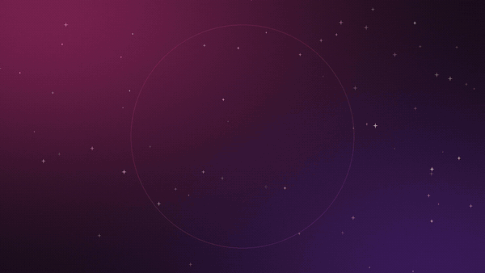

# Roseblox

**Play Roblox on Linux.** Roseblox is a desktop app that installs, updates and launches Roblox Player and Roblox Studio on Linux, with a normal app window and menu entry, not a terminal script.

[](marketing/video/roseblox-sneak-peek.mp4)

Click the preview to watch the full 30-second video with sound.

## How it works, in short

Roblox does not make a Linux version, but it does make a macOS one. Roseblox downloads the official macOS Roblox apps straight from Roblox's own servers and runs them through [Rosemary](https://aur.archlinux.org/packages/rosemary), a separate open-source program that runs macOS apps on Linux, translating Roblox's Metal graphics to Vulkan.

Roseblox does the rest for you: it sets up Rosemary, installs and updates Player and Studio, opens **Play** buttons on roblox.com, and keeps your settings and mods in one place. It never changes Roblox's code.

Want the details? See [How Roseblox works](docs/HOW-IT-WORKS.md).

## Can I use it?

| | |
| --- | --- |
| **Works on** | Arch Linux and Arch-based systems such as CachyOS and EndeavourOS |
| **You need** | A graphics driver with Vulkan (AMD, Intel or NVIDIA), and an AUR helper such as `paru` or `yay` (the install guide shows how to get one) |
| **Not yet** | Ubuntu, Debian, Fedora, Flatpak or AppImage |

## Install

The AUR package has not been published yet, so `paru -S roseblox` does not find it; you build the package from this repository instead. The full walkthrough, with screenshots, is in **[the install guide](docs/INSTALL.md)**. If you already have `git`, `base-devel` and an AUR helper, it comes down to:

```sh
git clone https://github.com/MadnessMyth/RoseBlox.git ~/RoseBlox
cd ~/RoseBlox/packaging/arch-git
makepkg -si
```

Then open **Roseblox** from your application menu. A short setup walks you through four steps:

1. **Install Rosemary.** One click opens a terminal that installs it from the AUR. It builds from source, so this takes a while the first time.
2. **Open Roblox links with Roseblox** (optional), so **Play** on roblox.com starts the game.
3. **Install Roblox Player, Studio, or both**, with a progress bar.
4. **Update notifications** (optional), so you hear when Roblox releases a new version.

To update Roseblox later, see [Update](docs/INSTALL.md#update). To remove it, see [Uninstall](docs/INSTALL.md#uninstall).

## What you get

- **Join games from the website.** Play buttons and Studio sign-in links open through Roseblox.
- **Automatic Roblox updates.** A desktop notification with **Update** and **Skip This Version** when a new version is out.
- **Performance settings** for Player and Studio separately: GPU choice, frame pacing, Feral GameMode, the MangoHud overlay, FastFlags checked against Roblox's allowlist, and a tool to measure and compare runs.
- **Mods:** your own fonts, mouse cursor, skyboxes, sounds and textures. Roblox's original files are kept and put back when you turn a mod off.
- **While Playing:** Discord Rich Presence with Join Server, and a notification with the location of the server you joined.
- **More than one Roblox Player** at the same time, side by side.
- **Studio:** open `.rbxl` and `.rbxlx` place files directly.
- **Your look:** dark or light, Roseblox's pink theme or your desktop's colors, and a choice of accent colors.

## Help

Something not working? Start with [Troubleshooting](docs/INSTALL.md#troubleshooting). Logs are in `~/.local/state/roseblox/logs/` (`player.log`, `studio.log`, `roseblox.log`); include them when you report a problem.

## For developers

To run Roseblox from a checkout without installing it, install `gtk4`, `libadwaita` and `python-gobject`, then run:

```sh
PYTHONPATH=src python3 -m roseblox
```

[How Roseblox works](docs/HOW-IT-WORKS.md) covers the launch flow, where files are stored and how each feature works. See also the [release checklist](packaging/RELEASE.md) and [Flatpak and AppImage notes](packaging/DISTRIBUTION.md).

## License

Roseblox is licensed under the MIT License; see [LICENSE](LICENSE). It does not include Rosemary or Roblox: Rosemary comes from the AUR, and Roblox is downloaded from Roblox. Roseblox is not affiliated with Roblox Corporation.
