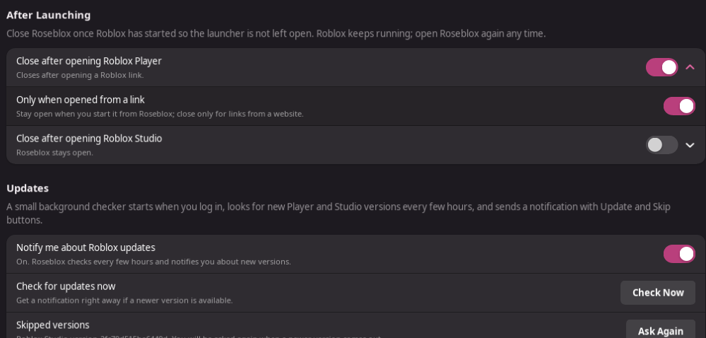

# Installing and updating Roseblox

This guide is for Arch Linux and Arch-based distributions such as CachyOS and EndeavourOS. It installs the latest Roseblox from the `master` branch as the `roseblox-git` package. Updates then take a single command.

## Install

### 1. Install the build tools

```sh
sudo pacman -S --needed git base-devel
```

### 2. Install an AUR helper (skip if you already have `paru` or `yay`)

Roseblox installs Rosemary through an AUR helper. To install `paru`:

```sh
git clone https://aur.archlinux.org/paru-bin.git /tmp/paru-bin
cd /tmp/paru-bin
makepkg -si
```

### 3. Make sure you have a Vulkan driver

Roblox draws through Vulkan. Most desktops already have one; if not, install the one for your GPU:

```sh
sudo pacman -S --needed vulkan-radeon    # AMD
sudo pacman -S --needed vulkan-intel     # Intel
sudo pacman -S --needed nvidia-utils     # NVIDIA (proprietary driver)
```

### 4. Download Roseblox

```sh
git clone https://github.com/MadnessMyth/RoseBlox.git ~/RoseBlox
```

Keep this folder; you will use it to update.

### 5. Build and install

```sh
cd ~/RoseBlox/packaging/arch-git
makepkg -si
```

Run this as your normal user, not with `sudo`. `makepkg` asks for your password when it installs the package. If you previously installed the older `roseblox` package from `packaging/arch`, pacman asks whether to replace it. Answer `y`.

With `paru`, you can build the same folder instead. Roseblox is not on the AUR yet, so `paru -S roseblox` does not find it:

```sh
paru -Bi ~/RoseBlox/packaging/arch-git
```

Check that it worked:

```sh
pacman -Q roseblox-git
```

### 6. Run first-time setup

Open **Roseblox** from your application menu, or run `roseblox` in a terminal. The setup page has four steps:


1. **Rosemary** – click **Install Rosemary**. A terminal opens and runs `paru -S --needed rosemary sdl3 vulkan-icd-loader` (or `yay`). Review the package, confirm, and enter your password. Rosemary compiles from source, which took about 20 minutes on a test machine. The terminal then runs `rosemary prefix create`, which downloads Rosemary's macOS base system once (about 180 MB). Press Enter to close the terminal when it finishes. Roseblox detects Rosemary on its own and marks the step **Ready**. If you already have a Rosemary build or AppImage, use **Choose…** instead.
2. **Roblox Links** (optional) – turn on **Open Roblox links with Roseblox** so that **Play** buttons on roblox.com and Studio sign-in links open through Roseblox.
3. **Player and Studio** – click **Install** for Roblox Player, Roblox Studio, or both. The download runs on the page with a progress bar.
4. **Updates** (optional) – turn on **Notify me about Roblox updates** to get a desktop notification with **Update** and **Skip This Version** buttons whenever Roblox releases a new Player or Studio version. See [Roblox Player and Studio](#roblox-player-and-studio) below.


Click **Finish Setup**. You can reopen setup at any time from **Settings → First-time setup → Open Setup**.

## Update

### Roseblox

```sh
cd ~/RoseBlox
git checkout -- packaging/arch-git/PKGBUILD
git pull
cd packaging/arch-git
makepkg -si
```

Or as one line:

```sh
cd ~/RoseBlox && git checkout -- packaging/arch-git/PKGBUILD && git pull && cd packaging/arch-git && makepkg -si
```

`makepkg` writes the version it built into `PKGBUILD`, so the `git checkout` line discards that edit before `git pull`; otherwise the pull can refuse to run. `git pull` updates the packaging recipe, and `makepkg` fetches and builds the latest `master`. Your settings, installations and link choice are kept. `pacman -Q roseblox-git` shows the new version, for example `0.2.0.r3.g1a2b3c4-1`, where the last part is the commit it was built from.

### Rosemary

Rosemary updates with your other AUR packages:

```sh
paru -Syu    # or: yay -Syu
```

Click **Check Again** under Rosemary in Settings if Roseblox is already open.

### Roblox Player and Studio

With **Settings → Updates → Notify me about Roblox updates** on, Roseblox checks in the background (one minute after you log in, then every three hours) and shows a notification when a new version is out:

- **Update** opens Roseblox, downloads and installs the new version with a progress bar, and makes it the version that Home and Roblox links open.
- **Skip This Version** hides that version; you are notified again when a newer one is released. **Settings → Updates → Ask Again** undoes skips.
- If you ignore the notification, it comes back after a day. **Check Now** in Settings checks immediately.

To update by hand, open the **Player** or **Studio** page, click **Refresh Version** to see the latest Roblox version, then click **Download and Install Latest**. To make the new version the default on Home, click **Set as preferred** on its row. Either way, older versions stay installed until you click **Remove**.

### Closing Roseblox after launching



**Settings → After Launching** has a separate switch for Player and for Studio. With **Close after opening Roblox Player** on, Roseblox closes itself five seconds after Player starts; Roblox keeps running. Turn on **Only when opened from a link** to close only when you join a game from the website, and stay open when you press **Play** in Roseblox. Roseblox stays open if the app exits during those five seconds (so you can read the error) or while a download is running.

## Tagged releases instead of `master`

If you only want tagged releases such as `v0.2.0`, build the `roseblox` package from `packaging/arch` in step 5 instead:

```sh
cd ~/RoseBlox/packaging/arch
makepkg -si
```

To update after a new release, run `git pull` in `~/RoseBlox`, then `makepkg -si` in `packaging/arch` again. This recipe does not modify itself, so no `git checkout` step is needed. To switch between `roseblox` and `roseblox-git`, build the other one; pacman offers to replace the installed package.

## Uninstall

1. In **Settings → Roblox Links**, turn off **Open Roblox links with Roseblox**. This restores the previous link handler. In **Settings → Updates**, turn off **Notify me about Roblox updates**; this stops the checker and removes its login entry. (If you already removed Roseblox, delete `~/.config/autostart/io.github.roseblox.Roseblox.Updater.desktop` and `~/.local/share/applications/io.github.roseblox.Roseblox.Updater.desktop`.)
2. Remove the package:

   ```sh
   sudo pacman -R roseblox-git    # or: sudo pacman -R roseblox
   ```

3. Optional: delete downloaded Roblox apps and settings:

   ```sh
   rm -rf ~/.local/share/roseblox ~/.config/roseblox ~/.local/state/roseblox
   ```

4. Optional: remove Rosemary with `sudo pacman -R rosemary`.

## Troubleshooting

| Problem | Fix |
| --- | --- |
| "No AUR helper found" | Install `paru` (step 2) or `yay`, then click **Try Again**. |
| "No supported terminal found" | Install a terminal such as `kitty`, `konsole` or `gnome-console`, or set the `TERMINAL` environment variable. |
| Rosemary installed, but Roseblox says it is missing | Click **Check Again**. If Rosemary is outside `PATH`, use **Settings → Executable → Choose…**. |
| Roblox links open the wrong app, or a "Choose application" window appears without Roseblox | Make sure **Settings → Roblox Links → Open Roblox links with Roseblox** is on. If it already is, click **Repair** (needed once after updating from v0.2.0), or turn the switch off and on again. If your browser asks, choose **Roseblox** and tick "always". |
| ZIP import fails with "bsdtar" | `sudo pacman -S --needed libarchive` |
| Roblox closed or failed and you want its output | Rosemary's output is in `~/.local/state/roseblox/logs/player.log` or `studio.log`; the previous run is in `player.log.1` or `studio.log.1`. |
| No update notifications | Check that **Settings → Updates** says "On". If it says the login entry is missing, turn the switch off and on again. Make sure notifications for "Roseblox" are allowed in your desktop's notification settings, then click **Check Now**. You are only notified for apps you have installed, and not for a version you skipped. |
| Clicking **Update** in a notification does nothing | See `~/.local/state/roseblox/logs/roseblox.log` for the window it opened. |
