# Installing and updating Roseblox

This guide is mainly for Arch Linux and Arch-based distributions such as CachyOS and EndeavourOS. It installs the latest Roseblox from the `master` branch as the `roseblox-git` package. Updates then take a single command. On Ubuntu, Debian, Fedora or openSUSE, follow [Other distributions](#other-distributions) instead. To learn what Roseblox does behind the scenes, see [How Roseblox works](HOW-IT-WORKS.md).

## Install

### 1. Install the build tools

```sh
sudo pacman -S --needed git base-devel
```

### 2. Install an AUR helper (skip if you already have `paru` or `yay`)

Roseblox installs Rosemary through an AUR helper. To install `paru`:

```sh
git clone https://aur.archlinux.org/paru-bin.git /tmp/paru-bin
cd /tmp/paru-bin
makepkg -si
```

### 3. Make sure you have a Vulkan driver

Roblox draws through Vulkan. Most desktops already have one; if not, install the one for your GPU:

```sh
sudo pacman -S --needed vulkan-radeon    # AMD
sudo pacman -S --needed vulkan-intel     # Intel
sudo pacman -S --needed nvidia-utils     # NVIDIA (proprietary driver)
```

### 4. Download Roseblox

```sh
git clone https://github.com/MadnessMyth/RoseBlox.git ~/RoseBlox
```

Keep this folder; you will use it to update.

### 5. Build and install

```sh
cd ~/RoseBlox/packaging/arch-git
makepkg -si
```

Run this as your normal user, not with `sudo`. `makepkg` asks for your password when it installs the package. If you previously installed the older `roseblox` package from `packaging/arch`, pacman asks whether to replace it. Answer `y`.

With `paru`, you can build the same folder instead. Roseblox is not on the AUR yet, so `paru -S roseblox` does not find it:

```sh
paru -Bi ~/RoseBlox/packaging/arch-git
```

Check that it worked:

```sh
pacman -Q roseblox-git
```

### 6. Run first-time setup

Open **Roseblox** from your application menu, or run `roseblox` in a terminal. The setup page has five steps:

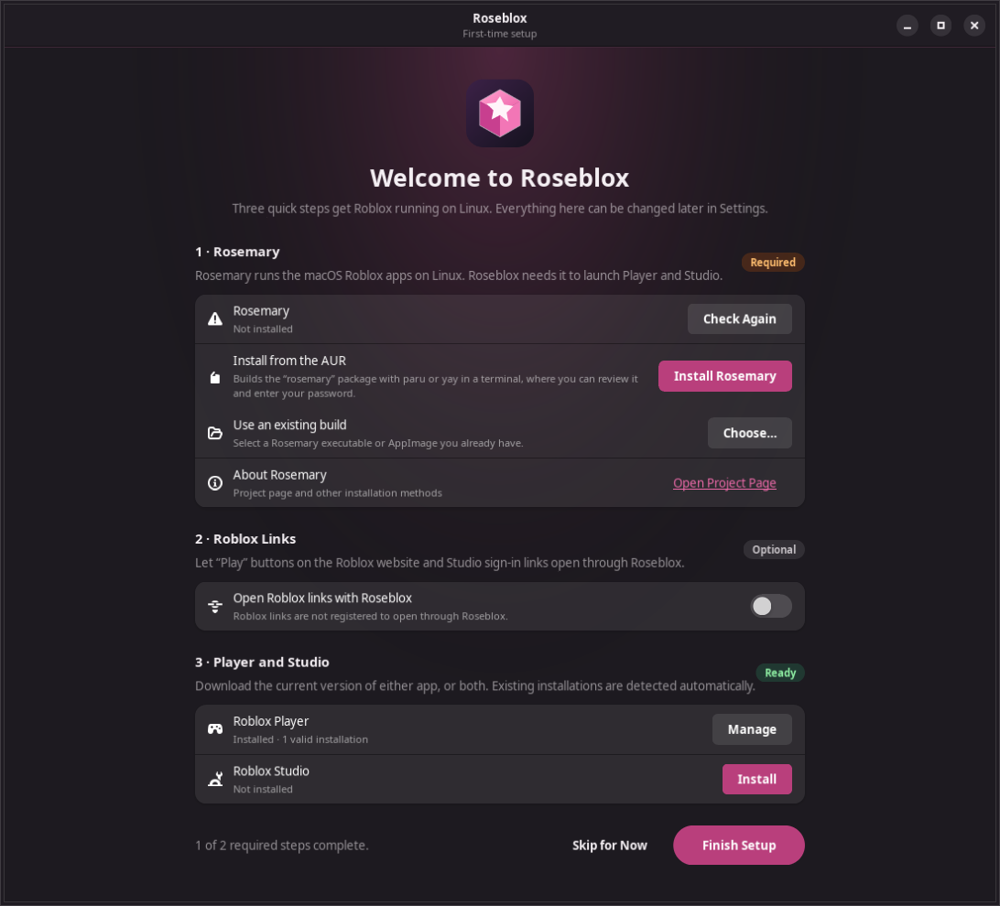

1. **Rosemary** – click **Install Rosemary**. A terminal opens and runs `paru -S --needed rosemary sdl3 vulkan-icd-loader` (or `yay`). Review the package, confirm, and enter your password. Rosemary compiles from source, which took about 20 minutes on a test machine. The terminal then runs `rosemary prefix create`, which downloads Rosemary's macOS base system once (about 180 MB). Press Enter to close the terminal when it finishes. Roseblox detects Rosemary on its own and marks the step **Ready**. If you already have a Rosemary build or AppImage, use **Choose…** instead.
2. **Roblox Links** (optional) – turn on **Open Roblox links with Roseblox** so that **Play** buttons on roblox.com and Studio sign-in links open through Roseblox.
3. **Player and Studio** – click **Install** for Roblox Player, Roblox Studio, or both. The download runs on the page with a progress bar.
4. **Updates** (optional) – turn on **Notify me about Roblox Player updates** and/or **Notify me about Roblox Studio updates** to get a desktop notification with **Update** and **Skip This Version** buttons whenever Roblox releases a new version of that app. Under each one that is on, **Automatically update … in the background** installs new versions without asking. See [Roblox Player and Studio](#roblox-player-and-studio) below.
5. **Settings from Another App** (optional) – if you used Roséline, Quadra, Sober, Vinegar, Bloxstrap or a FastFlag tool before, click **Import…** to bring its FastFlags and settings over. See [Importing from another app](#importing-from-another-app).

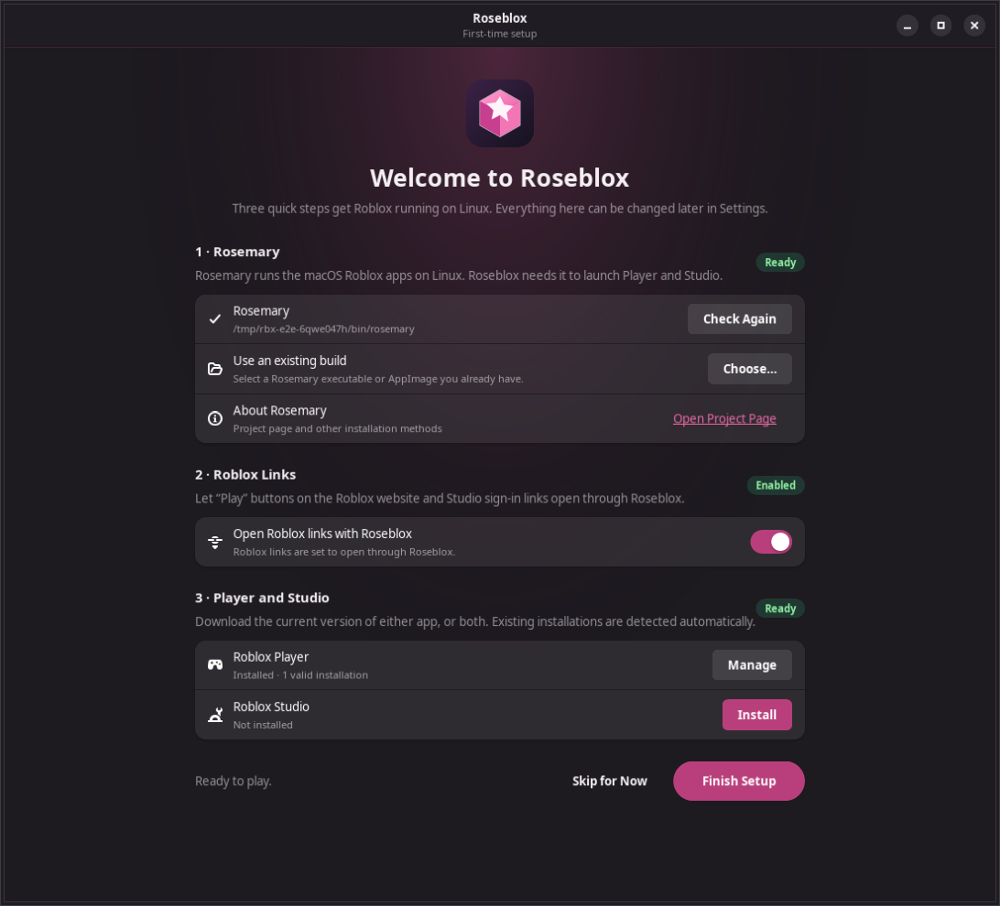

Click **Finish Setup**. You can reopen setup at any time from **Settings → First-time setup → Open Setup**.

## Other distributions

Roseblox 0.5.0 and later also run on Ubuntu 24.04 or newer, Debian 13, Fedora 40 or newer and openSUSE Tumbleweed. These systems are less tested than Arch, so please report anything that does not work. There are three ways to install Roseblox on them; the AppImage is the easiest.

You also need a Vulkan driver for your GPU. Most desktops already have one: Mesa provides it for AMD and Intel, and NVIDIA's own driver provides it for NVIDIA.

### AppImage

1. Download `Roseblox-x86_64.AppImage` from the [latest release](https://github.com/MadnessMyth/RoseBlox/releases/latest). Keep it somewhere it can stay, for example `~/Applications`.
2. Make it executable: right-click it, open **Properties** and turn on **Allow executing as program** (the wording differs between file managers), or run `chmod +x ~/Applications/Roseblox-x86_64.AppImage`.
3. Double-click it. On first start, Roseblox adds itself to your application menu with its icon, so afterwards you can open it from there. If you move the file, open it once from its new place and the menu entry follows.

The AppImage contains Python, GTK 4, libadwaita and `bsdtar`, so nothing else has to be installed. It needs a system at least as new as Ubuntu 24.04 (glibc 2.39), and a 64-bit Intel or AMD (x86-64) computer. It opens through FUSE, which desktop systems include; if it does not start, install the `fuse3` package.

### .deb package (Ubuntu and Debian)

Download `roseblox_<version>_all.deb` from the [latest release](https://github.com/MadnessMyth/RoseBlox/releases/latest), then install it from the folder you downloaded it to:

```sh
sudo apt install ./roseblox_*_all.deb
```

apt installs the GTK libraries it needs. Roseblox then appears in your application menu. Ubuntu's App Center can open the file too.

### Install script

This installs Roseblox from the source code for your user only, using your system's Python, GTK 4 (4.10 or newer) and libadwaita (1.4 or newer). First install Git and those libraries:

```sh
# Ubuntu, Debian, Linux Mint, Pop!_OS
sudo apt install git python3-gi gir1.2-gtk-4.0 gir1.2-adw-1 libarchive-tools xdg-utils

# Fedora
sudo dnf install git python3-gobject gtk4 libadwaita bsdtar xdg-utils

# openSUSE Tumbleweed
sudo zypper install git python3-gobject python3-gobject-Gdk typelib-1_0-Gtk-4_0 typelib-1_0-Adw-1 bsdtar xdg-utils
```

Then download Roseblox and run the script:

```sh
git clone https://github.com/MadnessMyth/RoseBlox.git ~/RoseBlox
~/RoseBlox/packaging/generic/install.sh
```

Run the script as your normal user, not with `sudo`. It checks the libraries above and tells you the exact command if one is missing. It installs:

- the app in `~/.local/lib/roseblox`
- the `roseblox` command in `~/.local/bin`
- the menu entry and icon in `~/.local/share`

If it says `~/.local/bin` is not in your `PATH`, log out and back in. Most distributions add that folder at login once it exists. The `roseblox` command must be found there for Roblox links and update notifications to work.

### Get Rosemary

Open **Roseblox** from your application menu. On these systems the Rosemary step offers **Download the AppImage** instead of the AUR:

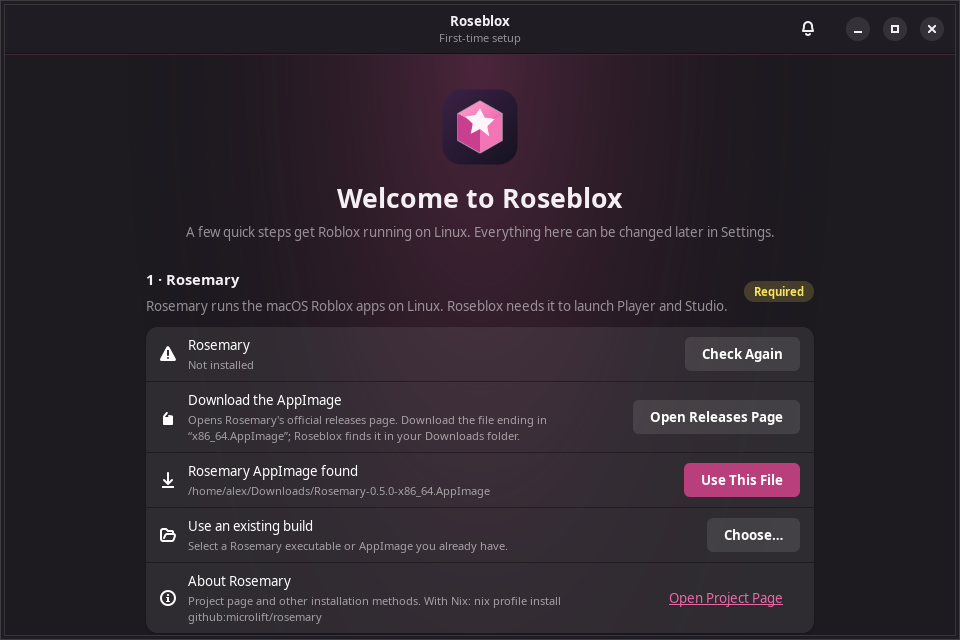

1. Click **Open Releases Page**. Rosemary's official releases page opens in your browser.
2. Download the file ending in `x86_64.AppImage`, for example `Rosemary-0.5.0-x86_64.AppImage`.
3. Roseblox looks in your Downloads folder, `~/Applications`, `~/.local/bin` and `~/bin`. When it finds the file, **Rosemary AppImage found** appears. Click **Use This File**; Roseblox makes the file executable and uses it from where it is. If you move or delete the file later, choose it again in setup or **Settings → Advanced**.

This is Rosemary's AppImage, separate from Roseblox's own. The first time Roblox starts, Rosemary offers to download its macOS base system (about 180 MB) once.

Other ways to get Rosemary also work, as long as the result is a `rosemary` command in your `PATH` or a file you pick with **Choose…**:

- With Nix: `nix profile install github:microlift/rosemary`
- Build it from source with the instructions in [Rosemary's README](https://github.com/microlift/rosemary#building). This needs SDL 3.4 or newer.

Rosemary publishes its AppImage only for 64-bit Intel and AMD (x86-64) computers. On ARM computers, setup does not offer the download; use Nix or build Rosemary from source.

Then continue with steps 2 to 4 of [first-time setup](#6-run-first-time-setup).

### Updating on other distributions

Roseblox looks for new versions of itself once a day while it is open, and the bell shows **Roseblox X.Y.Z is available** when there is one. Turn this off in **Settings → Updates → Check for new Roseblox versions**.

- **AppImage**: click **Update** in the bell. Roseblox downloads the new AppImage, checks it against the release's checksums, replaces the old file, and offers **Restart**.
- **.deb**: click **Open Release**, download the new `.deb` and install it with `sudo apt install ./roseblox_*_all.deb` again.
- **Install script**: run

  ```sh
  cd ~/RoseBlox && git pull && packaging/generic/install.sh
  ```

Your settings, installations and link choice are kept. To update Rosemary, download the newer AppImage and click **Use This File** again, or choose it in **Settings → Advanced**.

### Uninstalling on other distributions

Turn off **Open Roblox links with Roseblox** and both **Notify me about … updates** switches first, as in [Uninstall](#uninstall) step 1. Then:

- **AppImage**: delete the AppImage file, `~/.local/share/applications/io.github.roseblox.Roseblox.desktop` and `~/.local/share/icons/hicolor/scalable/apps/io.github.roseblox.Roseblox.svg`.
- **.deb**: `sudo apt remove roseblox`
- **Install script**: `~/RoseBlox/packaging/generic/install.sh --uninstall`

Follow [Uninstall](#uninstall) step 3 if you also want to delete your settings and Roblox apps.

## Settings

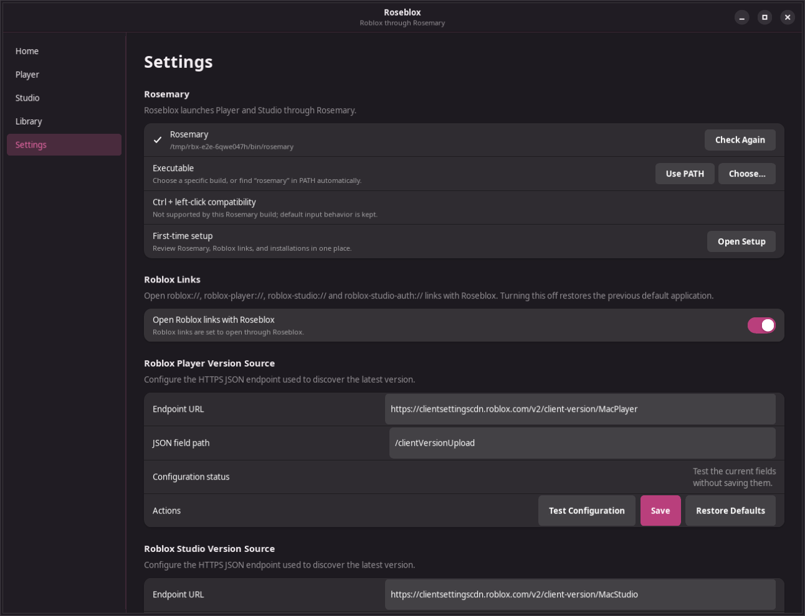

Click a section heading in **Settings** to open or close it; Roseblox remembers your choice.

- **Appearance**: **Colors** (Roseblox or System), **Style** (Dark, Light, or Follow system), and **Accent color** (Roseblox pink, your desktop's accent color, or a fixed color). Changes apply immediately.
- **Rosemary**: Rosemary status, **Ctrl + left-click compatibility** (turn it off if you want Rosemary's default Ctrl + click behavior), **First-time setup**, and **Import from another app**.
- **After Launching**: close Roseblox after Player or Studio starts, and **Allow more than one Roblox Player**. See [Closing Roseblox after launching](#closing-roseblox-after-launching) and [More than one Roblox Player](#more-than-one-roblox-player).
- **While Playing**: Discord Rich Presence, a server location notification (optionally shown inside the game), closing Roblox when you leave a game, and the microphone toggle. See [While Playing](#while-playing).
- **Roblox Links**: open `roblox://` links with Roseblox.
- **Updates**: update notifications, **Check Now**, skipped versions, and **Check for new Roseblox versions**.
- **Advanced** (closed by default): the Rosemary executable path, the Player and Studio version sources, and the Discord application ID. You normally do not need to change these.

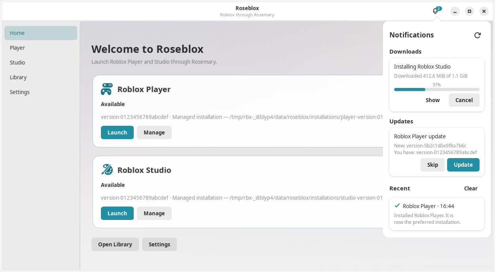

### While Playing

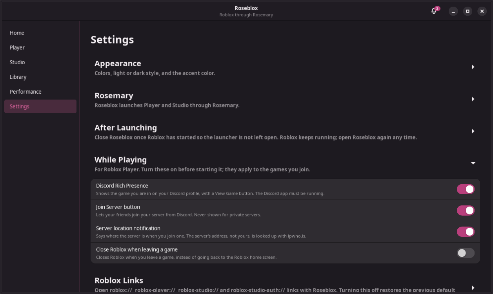

These work with Roblox Player and are off until you turn them on. Turn them on before you start the Player; they apply to every game you join after that, even if Roseblox closes.

- **Discord Rich Presence**: your Discord profile shows "Playing Roseblox" with the game's name, creator and icon, and how long you have been in it. Other people see a **View Game** button and, while **Join Server button** is on, a **Join Server** button that opens Roblox's own join page for your server. Private servers never get a Join Server button. The Discord desktop app must be running; the regular, Flatpak and Snap builds all work. Discord only shows the buttons to other people, not to you.
- **Server location notification**: when you join a server, a notification says where it is, for example "The server is in Frankfurt am Main, Hessen, Germany." The Roblox server's address (never yours) is looked up with [ipwho.is](https://ipwho.is).
  - **Show inside the game** (appears once the notification is on, and is on by default): desktops hold notifications back while a game is fullscreen, so this shows "Server: Frankfurt am Main, Hessen, Germany" at the top of the Roblox window for 10 seconds instead, fullscreen or not. It is drawn by [MangoHud](https://github.com/flightlessmango/MangoHud), which must be installed (`mangohud` package); the row shows a warning and the install command if it is not, and you get the desktop notification until then. If the banner does not work on your system, turn this off to get the desktop notification instead. It applies from the next Player launch. With the **MangoHud overlay** switch on (Performance), your MangoHud setup comes back after the 10 seconds; with it off, MangoHud is loaded but shows nothing else.
- **Close Roblox when leaving a game**: Roblox closes when you leave a game, instead of going back to the Roblox home screen. Being disconnected does not close it.
- **Microphone toggle**: Roblox's microphone stays silent until you use a hotkey, like push to talk in other games. Roblox stays connected to voice chat and keeps its own microphone switch; it just receives silence. Discord and other apps keep your microphone as usual.
  - **Microphone hotkey**: click **Set Hotkey** and choose the key in the small dialog your desktop shows (KDE Plasma does this). **Change Hotkey** opens the desktop's shortcut settings; on KDE Plasma the key is also listed under Roseblox in **System Settings → Keyboard → Shortcuts**. The key works while Roblox has focus. Desktops without global shortcuts (the xdg-desktop-portal GlobalShortcuts service) can bind a key to `roseblox --mic toggle` in their keyboard settings instead.
  - **Mode**: **Toggle** turns the microphone on with one press and off with the next. **Hold** keeps it on while the key is held down.
  - **Inverted** (Hold only): push to mute. The microphone is on, and muted while the key is held down.
  - **Release delay** (Hold only): how many milliseconds the microphone stays on after you let go, so the end of a sentence is not cut off. With **Inverted**, how long you stay muted after letting go.
  - **Sound effects**: a short sound when Roblox's microphone turns on (two rising notes) or off (two falling notes). **Choose…** uses your own WAV, Ogg or FLAC file instead (up to 2 MiB; Roseblox keeps a copy), **Use Roseblox's** goes back, and the play button previews it. **Sound volume** is a percentage of your system volume. The sounds play through `pw-play` (PipeWire) or `paplay`.

  `roseblox --mic status` prints whether the microphone is on, and `roseblox --mic toggle`, `on` and `off` switch it, while a Player runs with the toggle on.

  The toggle works with PipeWire and with PulseAudio. If neither sound server is running (for example a setup with only ALSA or JACK), or the programs it needs are missing, Settings shows a warning under **Microphone toggle** that says which, and `roseblox --mic` prints the same reason. A warning icon on **Sound effects** means neither `pw-play` nor `paplay` is installed.

Roseblox reads these events from the log the Roblox Player writes inside the Rosemary prefix (`~/Library/Logs/Roblox` in the guest, normally `~/.local/share/rosemary/prefixes/default/root/Users/<you>/Library/Logs/Roblox`). Each Player's own open log is used, so several Players do not mix up their games. `~/.local/state/roseblox/logs/activity.log` records which log was followed, each game joined, and any problem.

### Importing from another app

**Settings → Rosemary → Import from another app** (also step 5 of first-time setup) copies FastFlags and settings from another launcher. It lists every supported app, with the files it found. Click **Preview**, or **Choose…** to pick the file or folder yourself, for example a Wine prefix that is not in the usual place.

The preview shows:

- What will be imported, grouped by **Roblox Player**, **Roblox Studio** and **Roseblox**. Untick anything you do not want.
- Rows that would replace a setting you already have, with your value and the new one. These are not ticked; tick them to replace, and Roseblox asks once more before it does.
- **Already the same**: settings Roseblox already has. Importing again only offers what changed.
- **Not imported**: each setting that is **Invalid** (with the reason), **Unsupported** (Roseblox has no equivalent) or **Skipped** (the other app does not use it either).

Nothing is saved until you click **Import**, and everything is checked first: if anything would be rejected, nothing is written. Roseblox keeps a backup of the Player and Studio configuration (see **Performance → Backups**). The other app's files are only read.

| App | Where Roseblox looks | What carries over |
| --- | --- | --- |
| [Roséline](https://github.com/buwryme/Roseline) | `~/.config/roseline/settings.toml` (also the Flatpak) | Player FastFlags (presets and your own), GPU, GameMode, environment variables, Discord, server location, Close on leave, classic avatar background, font |
| [Quadra](https://github.com/QuadraHQ/Quadra) | `~/.config/quadrahq/` (`settings.json`, `fastflags.json`) | Player and Studio FastFlags, GPU, Studio GameMode, MangoHud, presentation mode, refresh rate, titlebar, Command key, Ctrl + click, Discord, server location, classic death sound, font |
| [Sober](https://sober.vinegarhq.org/) | `~/.var/app/org.vinegarhq.Sober/config/sober/config.json` | FastFlags, GameMode, Discord, server location, Close on leave, classic death sound |
| [Vinegar](https://github.com/vinegarhq/vinegar) | `~/.config/vinegar/config.toml` | Studio FastFlags, GameMode and GPU |
| [Bloxstrap](https://github.com/bloxstraplabs/bloxstrap) | `AppData/Local/Bloxstrap` in a Wine prefix | FastFlags (Studio copies unticked), font, Discord, server location |
| [Roblox FastFlag Manager](https://github.com/4anti/Roblox-FastFlag-Manager) | `.FFlagManager/user_flags.json` in a Wine prefix | Turned-on flags |
| [Roblox Manager](https://github.com/Paryx-games/roblox-manager) | `AppData/Roaming/RM/config.json` in a Wine prefix | FastFlags |
| Any other app | the file you choose | A `ClientAppSettings.json`-style file of FastFlags |

Wine prefixes are looked for in `~/.wine`, `$WINEPREFIX`, `~/.local/share/wineprefixes`, Bottles (also the Flatpak), Lutris's `~/Games`, Steam's Proton prefixes and Grapejuice.

Things to know:

- Sign-in data is never read or imported: no cookies, tokens or accounts. Quadra's `web` folder and Roblox Manager's `accounts.dat` are not opened, and variables or values that look like credentials are rejected.
- FastFlags made for another client may do nothing here. Sober's flags were chosen for Roblox's Android app, Bloxstrap's and the FastFlag tools' for Windows, and Roblox only honors flags on its allowlist (see [Performance](#performance)).
- Roblox FastFlag Manager can save a flag without its `FFlag`/`FInt`/`DFInt` prefix. Roseblox then guesses the prefix from the flag's type, says so, and leaves it unticked.
- Settings from Windows tools that change the game's own options (Roblox Manager's FPS, graphics, fullscreen and mute) and Windows or Wine-only options are listed as **Unsupported**.

### Notification center

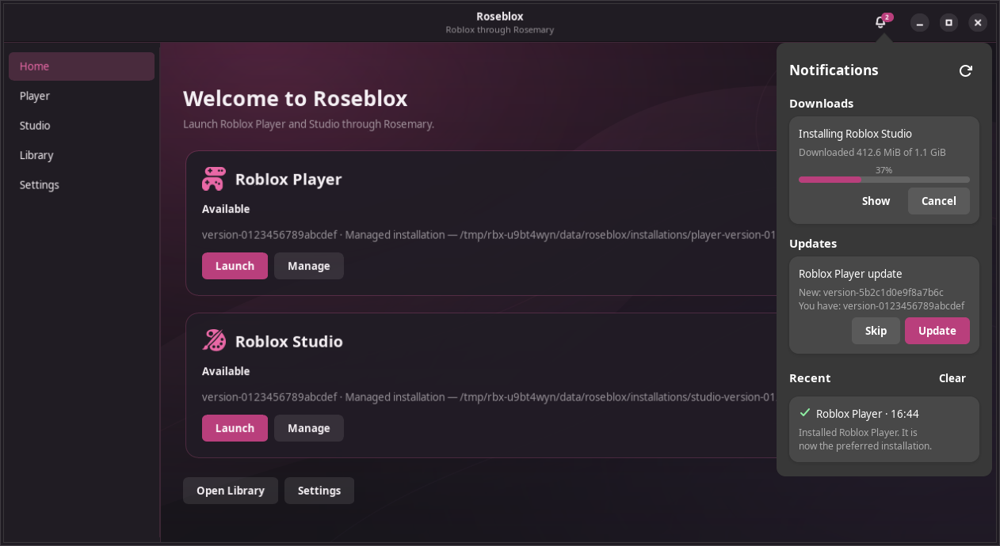

Click the bell at the top right. The badge counts the items in the center:

- **Downloads**: what is downloading or installing, with progress, speed, time left, and **Cancel**. The arrow opens the Player or Studio page.
- **Updates**: new Player and Studio versions, with **Update** and **Skip**, the same as the desktop notification.
- **Recent**: installs that finished or failed. Use **Clear** to remove them.
- **Roseblox**: a new version of Roseblox itself, with **Update** for the AppImage, or the way to update the .deb, install script or package. **Not Now** hides it until Roseblox restarts.

**Check for Updates** looks for new versions right away.

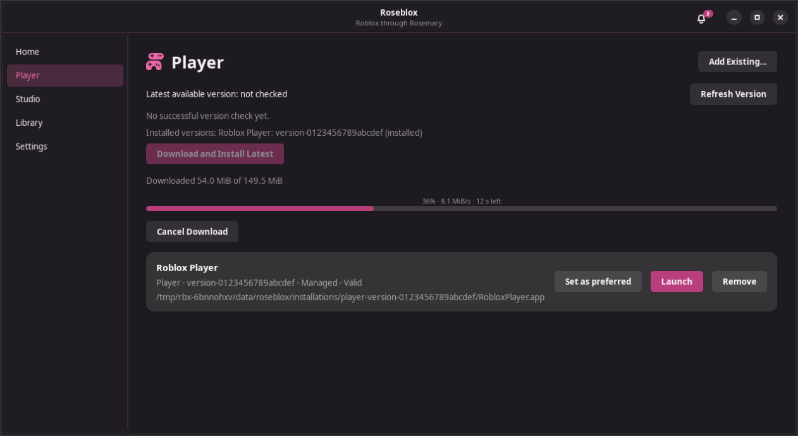

## Opening a place file in Studio

On the **Studio** page, click **Open Place…** next to an installation and choose a `.rbxl` or `.rbxlx` file. Studio opens it directly, the same as double-clicking it on a Mac. The file can be anywhere in your home folder.

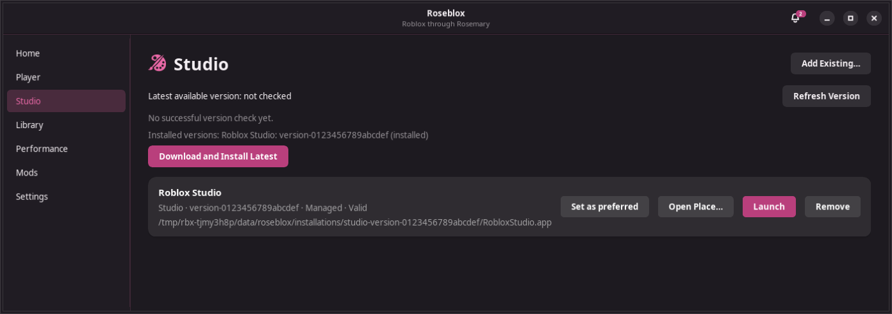

## Performance

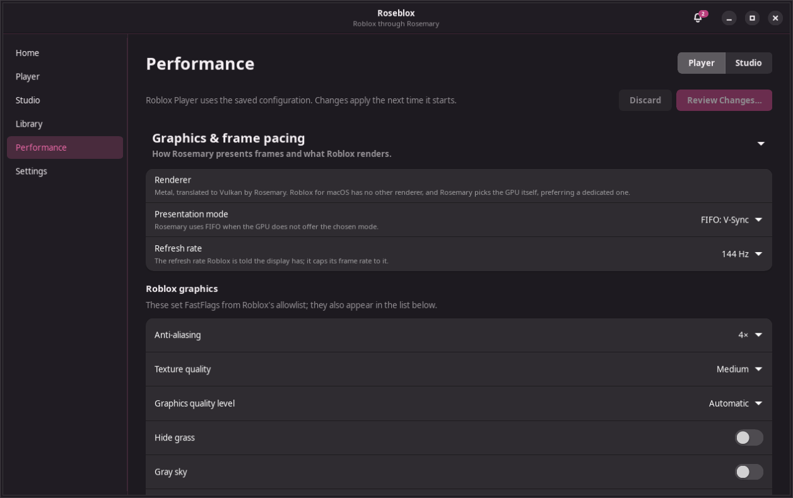

The **Performance** page holds launch settings for **Player** and **Studio** separately; pick one with the buttons at the top. Changes are only a draft until you click **Review Changes…**, which lists every change and saves it when you click **Apply**. **Discard** throws the draft away. The settings apply the next time that app starts, and nothing is set for your whole desktop.

- **Graphics & frame pacing**
  - **Preset**: **Balanced** (Rosemary's defaults), **Performance** (no anti-aliasing, low textures, no grass, and GameMode when it is installed), or **Visual Quality** (V-Sync, 4× anti-aliasing, high textures, and the highest graphics level). A preset changes only those settings; anything else you set stays. When you change one of them by hand, the preset shows **Custom**.
  - **GPU**: which graphics card Rosemary renders with, on computers with more than one.
  - **Presentation mode**: **Mailbox** (Rosemary's default: low latency, no tearing), **FIFO** (V-Sync), **FIFO relaxed** (V-Sync that may tear when a frame is late), or **Immediate** (lowest latency, may tear).
  - **Refresh rate**: the display refresh rate Roblox is told about. Roblox builds its in-game **Maximum Frame Rate** menu from this value, so choose your monitor's rate to get matching choices there. **Roblox frame rate cap** shows what that menu is set to.
  - **GameMode**: asks Feral GameMode (`gamemoded`) to optimize the system while the app runs. Install it with `sudo pacman -S gamemode`. If GameMode cannot start, the app still opens and the notification center says why.
  - **MangoHud overlay**: shows MangoHud's FPS and frame time overlay. Rosemary translates Metal to Vulkan, so MangoHud's Vulkan layer works. Install it with `sudo pacman -S mangohud`; the switch is greyed out until it is installed. Configure the overlay in `~/.config/MangoHud/MangoHud.conf`.
  - **Roblox graphics**: anti-aliasing, texture quality, graphics quality level, hide grass, gray sky, and disable DPI scaling. These are FastFlags from Roblox's allowlist, so they also work in Player.
- **FastFlags**: the flags written to the app's `ClientAppSettings.json` when it starts. The Player uses only flags in Roblox's own allowlist, which Roseblox downloads and marks; other flags are kept but have no effect there. Studio uses every flag. **Import…** and **Export…** read and write a JSON file, and **Use Flags from Installation** copies the flags already in the installed app. Roseblox never adds flags you did not choose, and backs up a `ClientAppSettings.json` it did not write before replacing it.
- **Keyboard & window**
  - **Command key**: which key acts as the Mac Command key. **Super, and Ctrl for editing** keeps Super as Command and also lets Ctrl+A, Ctrl+C, Ctrl+V, Ctrl+X, Ctrl+Y and Ctrl+Z work, which is handy in Studio. **Ctrl** and **Alt** make that key the Command key instead.
  - **Titlebar**: Rosemary's Mac-style titlebar, or your desktop's titlebar with the menus in a row below it.
- **Studio startup** (Studio only, closed by default): **Don't load my plugins** starts Studio with `-disableLoadUserPlugins`. Studio may start faster, but the plugins you installed are unavailable until you turn it off. Roblox's built-in tools still load.
- **Environment** (closed by default): extra variables for Rosemary, and variables for Roblox itself. Variables that look like passwords, tokens or cookies are refused, and so are library injection variables (`LD_PRELOAD`, `DYLD_*` and similar). Settings that have their own control, such as the presentation mode, must be changed there.
- **Launch arguments** (closed by default): extra arguments for Roblox, passed after the link Roseblox opens and never through a shell. Login ticket and authentication arguments are refused. The preview shows the whole command.
- **Backups** (closed by default): every change you apply first saves the previous settings of both apps. **Back Up Now** saves a copy at any time, **Restore…** brings one back, and **Reset to Defaults…** clears the settings of the selected app. **Export…** saves the Player and Studio settings to a file, and **Import…** loads such a file as unapplied changes for you to review and apply. The 30 newest backups are kept in `~/.config/roseblox/backups/`.
- **Caches** (closed by default): Rosemary's Metal shader cache and Roblox's caches, with their sizes. **Move to Trash…** moves one to your desktop's trash, so you can still get it back. Roblox and Rosemary rebuild them by themselves, so the first start afterwards can be slower. Your Roblox login and settings are never touched.
- **Diagnostics** (closed by default): Rosemary's version, what `rosemary prefix info` reports about the prefix, your GPUs and Vulkan drivers, whether GameMode and MangoHud are installed, and other details for bug reports. **Copy Report** copies them as text, and **Open Logs** opens the folder with Rosemary's output from the last two runs of Player and Studio.

- **Measure & compare** (closed by default): measures the running Player or Studio for 30 seconds to 5 minutes. It records CPU use (100% is one core), the busiest thread, memory, and GPU load and memory where the driver reports them (AMD's `amdgpu`, or NVIDIA's `nvidia-smi`; GPU figures cover the whole GPU). Each measurement is saved with the settings in use, such as the preset, presentation mode, graphics quality, Roblox and Rosemary versions, and your notes. Tick two and click **Compare Selected** to see them side by side with the differences highlighted, and a cautious note on whether the CPU or the GPU was the limit. Roblox does not report its frame rate, so use the MangoHud overlay for FPS and frame times. Measurements are kept in `~/.local/state/roseblox/measurements.json` (the 50 newest).

The settings are saved in `~/.config/roseblox/launch-config.json`.

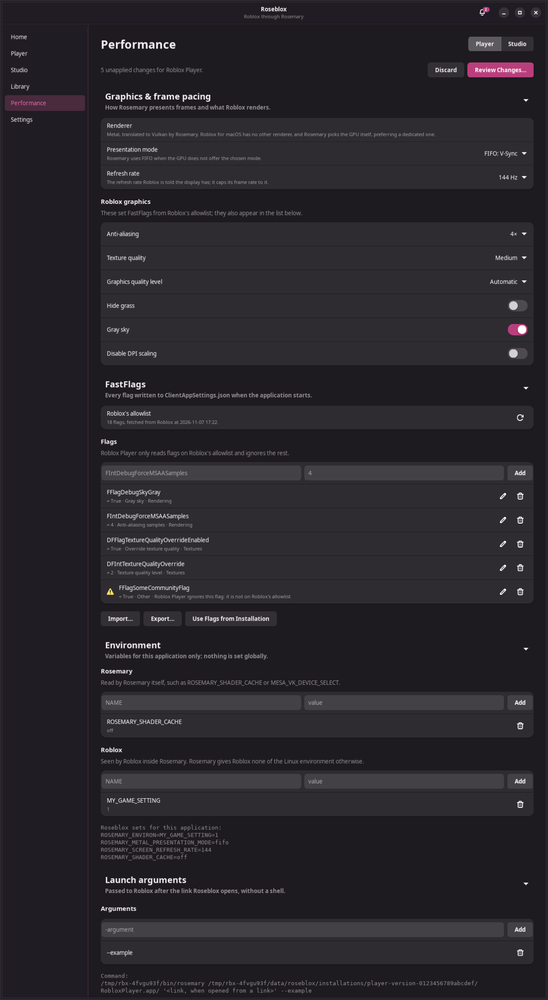

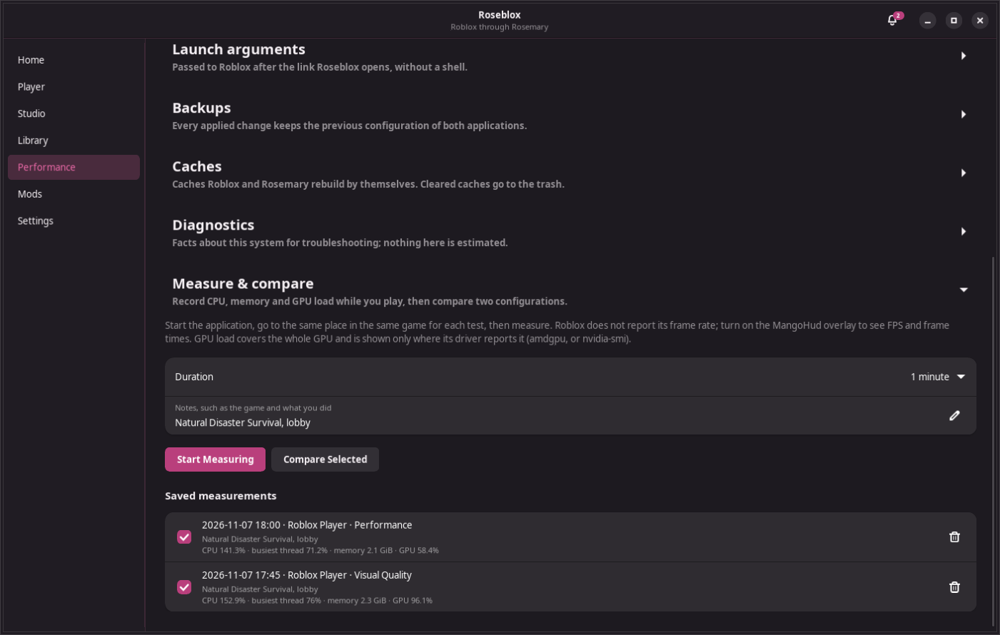

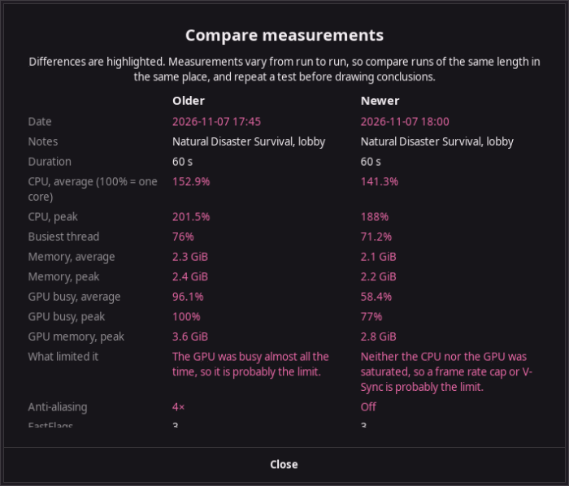

## Mods

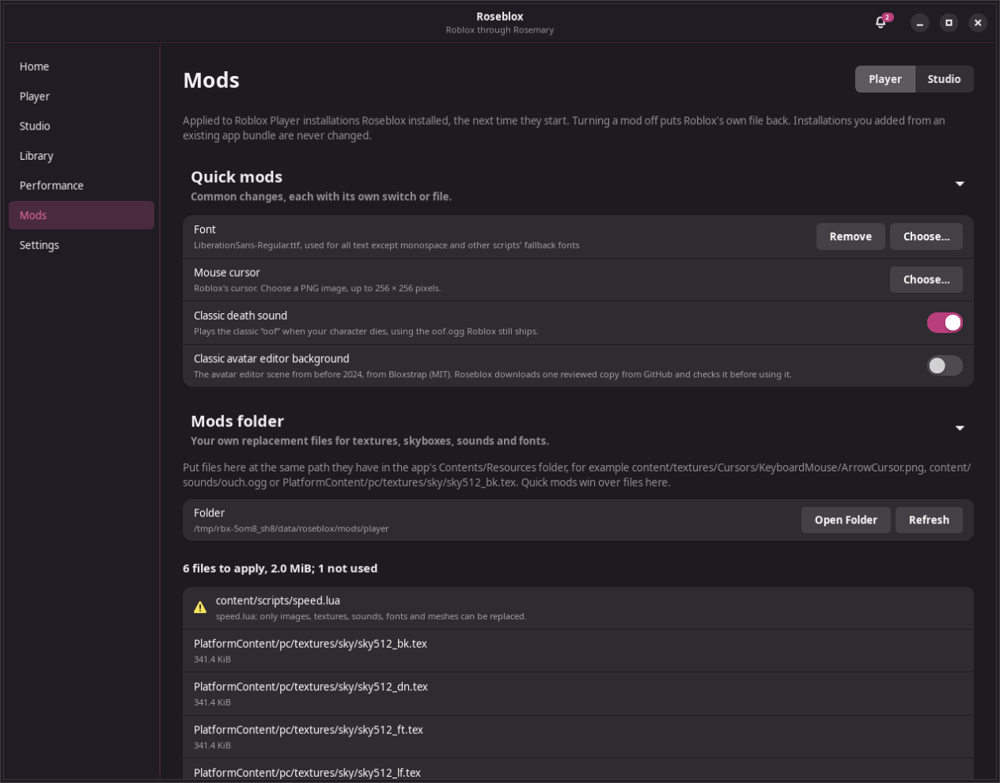

The **Mods** page changes Roblox's fonts, cursor, sounds and textures, separately for **Player** and **Studio**. Mods are applied to installations Roseblox installed, right before they start. Roblox's own files are backed up the first time, so turning a mod off puts them back. Installations you added from an existing app bundle are never changed.

- **Font**: choose a `.ttf` or `.otf` file to use it for all text. Monospace fonts and the fallback fonts for other scripts (such as Chinese, Japanese and Korean) are kept.
- **Mouse cursor**: choose a PNG image, up to 256 × 256 pixels, for the arrow cursor.
- **Classic death sound** (Player): the classic "oof", which Roblox still ships as `oof.ogg`.
- **Classic avatar editor background** (Player): the avatar editor scene from before 2024, from [Bloxstrap](https://github.com/bloxstraplabs/bloxstrap) (MIT). Roseblox downloads one reviewed copy and uses it only if it matches that copy exactly.
- **Mods folder**: your own files, for example skyboxes or textures. **Open Folder** opens `~/.local/share/roseblox/mods/player` (or `studio`). Put files there at the same path they have in the app's `Contents/Resources` folder, for example `PlatformContent/pc/textures/sky/sky512_bk.tex` for a skybox side or `content/sounds/ouch.ogg`. Only images, textures, sounds, fonts and meshes are used; anything else (such as scripts) is listed with the reason it is not used. Quick mods win over files in the folder.

## Update

### Roseblox

```sh
cd ~/RoseBlox
git checkout -- packaging/arch-git/PKGBUILD
git pull
cd packaging/arch-git
makepkg -si
```

Or as one line:

```sh
cd ~/RoseBlox && git checkout -- packaging/arch-git/PKGBUILD && git pull && cd packaging/arch-git && makepkg -si
```

`makepkg` writes the version it built into `PKGBUILD`, so the `git checkout` line discards that edit before `git pull`; otherwise the pull can refuse to run. `git pull` updates the packaging recipe, and `makepkg` fetches and builds the latest `master`. Your settings, installations and link choice are kept. `pacman -Q roseblox-git` shows the new version, for example `0.2.0.r3.g1a2b3c4-1`, where the last part is the commit it was built from.

Roseblox shows **Roseblox X.Y.Z is available** in the bell when a new release is out; on Arch, update with the commands above.

On other distributions, see [Updating on other distributions](#updating-on-other-distributions).

### Rosemary

On Arch, Rosemary updates with your other AUR packages:

```sh
paru -Syu    # or: yay -Syu
```

Click **Check Again** under Rosemary in Settings if Roseblox is already open.

### Roblox Player and Studio

**Settings → Updates** has one **Notify me about … updates** switch for Roblox Player and one for Roblox Studio, so you can leave out an app you do not use. With either on, Roseblox checks that app in the background (one minute after you log in, then every three hours) and shows a notification when a new version is out:

- **Update** opens Roseblox, downloads and installs the new version with a progress bar, and makes it the version that Home and Roblox links open.
- **Skip This Version** hides that version; you are notified again when a newer one is released. **Settings → Updates → Ask Again** undoes skips.
- If you ignore the notification, it comes back after a day. **Check Now** in Settings checks immediately.
- The same updates are listed in the [notification center](#notification-center) while Roseblox is open.

Under each app's switch, while it is on, is **Automatically update Roblox Player in the background** (or **… Roblox Studio …**), off by default and also in setup step 4. With it on, the checker installs that app's new version by itself in the background instead of asking, makes it the version Home and Roblox links open, and sends a notification when it is done. A version you chose **Skip This Version** for is not installed. If the automatic install fails, you get the normal notification with an **Update** button and the reason, and Roseblox does not retry that version on its own. A Roblox session that is already open keeps running on the old version until you close it.

To update by hand, open the **Player** or **Studio** page, click **Refresh Version** to see the latest Roblox version, then click **Download and Install Latest**. To make the new version the default on Home, click **Set as preferred** on its row. Either way, older versions stay installed until you click **Remove**.

### Closing Roseblox after launching

**Settings → After Launching** has a separate switch for Player and for Studio. With **Close after opening Roblox Player** on, Roseblox closes itself five seconds after Player starts; Roblox keeps running. Turn on **Only when opened from a link** to close only when you join a game from the website, and stay open when you press **Play** in Roseblox. Roseblox stays open if the app exits during those five seconds (so you can read the error) or while a download is running.

### More than one Roblox Player

Roblox Player allows only one copy of itself, and Rosemary enforces that: opening Player again shows the window that is already open, even from another installation and even with `rosemary --new-instance`. With the setting below on, Roseblox starts Player through the program inside the app bundle instead, which Rosemary always allows. To run two Players at once, for example to sign in to a different account in each, run them from two installations, so Roseblox can track and stop each one. Two different versions work, and so does a copy:

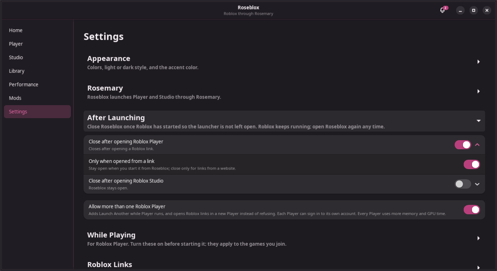

1. Turn on **Settings → After Launching → Allow more than one Roblox Player**.
2. On the **Player** page, click **Duplicate…** next to an installation, keep or change the suggested name (for example `Roblox Player (2)`), and click **Duplicate**. Roseblox copies the whole app in the background with a progress bar and **Cancel Copy**. It checks free space first and adds nothing to the Library if the copy fails or is cancelled. **Remove** is unavailable on the original while it is being copied.
3. Click **Launch** on the first installation, then **Launch** on the copy. Each has its own **Stop**.

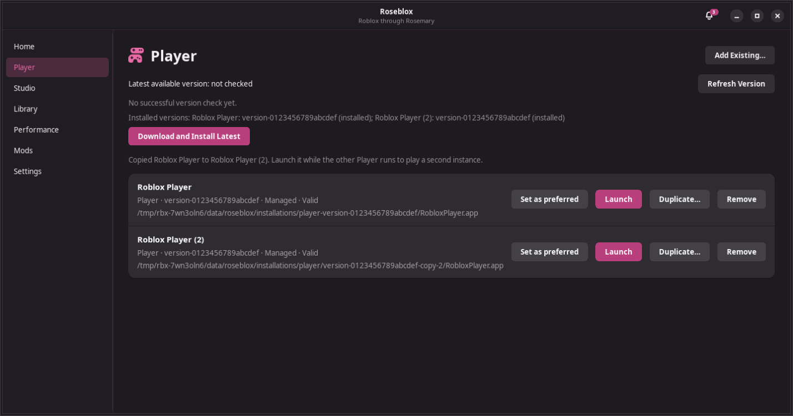

With the setting on, a Roblox link opened from the website while Player runs starts the first installation that is not running, preferring the same version. If every installation is running, Roseblox tells you to make another copy.

Each copy uses as much disk space as the original and is a managed installation, so **Remove → Delete Managed Bundle** deletes it. All Players share one Rosemary prefix, so Roblox settings and mods are shared. The first Player writes `player.log`, and a Player started while that log is in use writes `player-2.log`, `player-3.log`, and so on, so each Player's output stays in its own file. Update downloads do not update copies; duplicate the new version again if you want a copy of it.

## Tagged releases instead of `master`

If you only want tagged releases such as `v0.2.0`, build the `roseblox` package from `packaging/arch` in step 5 instead:

```sh
cd ~/RoseBlox/packaging/arch
makepkg -si
```

To update after a new release, run `git pull` in `~/RoseBlox`, then `makepkg -si` in `packaging/arch` again. This recipe does not modify itself, so no `git checkout` step is needed. To switch between `roseblox` and `roseblox-git`, build the other one; pacman offers to replace the installed package.

## Uninstall

1. In **Settings → Roblox Links**, turn off **Open Roblox links with Roseblox**. This restores the previous link handler. In **Settings → Updates**, turn off both **Notify me about … updates** switches; turning off the last one stops the checker and removes its login entry. (If you already removed Roseblox, delete `~/.config/autostart/io.github.roseblox.Roseblox.Updater.desktop` and `~/.local/share/applications/io.github.roseblox.Roseblox.Updater.desktop`.)
2. Remove the package:

   ```sh
   sudo pacman -R roseblox-git    # or: sudo pacman -R roseblox
   ```

   On other distributions, see [Uninstalling on other distributions](#uninstalling-on-other-distributions) instead.

3. Optional: delete downloaded Roblox apps and settings:

   ```sh
   rm -rf ~/.local/share/roseblox ~/.config/roseblox ~/.local/state/roseblox
   ```

4. Optional: remove Rosemary with `sudo pacman -R rosemary`, or delete the Rosemary AppImage you downloaded.

## Troubleshooting

| Problem | Fix |
| --- | --- |
| "No AUR helper found" | Install `paru` (step 2) or `yay`, then click **Try Again**. |
| The install script says GTK 4, libadwaita or PyGObject is missing | Run the command it prints, or the one for your distribution in [Other distributions](#1-install-the-libraries-roseblox-uses). If it says your version is too old, your distribution release is too old for Roseblox. |
| **Rosemary AppImage found** does not appear after downloading | Make sure the file name starts with `Rosemary` and ends in `.AppImage`, and that it is in your Downloads folder, `~/Applications`, `~/.local/bin` or `~/bin`. Click **Check Again**, or use **Choose…** to pick it anywhere. |
| Roblox links or update notifications say the `roseblox` command is not in PATH | Log out and back in so `~/.local/bin` is added to your `PATH`, then turn the switch on again. |
| "No supported terminal found" | Install a terminal such as `kitty`, `konsole` or `gnome-console`, or set the `TERMINAL` environment variable. |
| Rosemary installed, but Roseblox says it is missing | Click **Check Again**. If Rosemary is outside `PATH`, use **Settings → Executable → Choose…**. |
| Roblox links open the wrong app, or a "Choose application" window appears without Roseblox | Make sure **Settings → Roblox Links → Open Roblox links with Roseblox** is on. If it already is, click **Repair** (needed once after updating from v0.2.0), or turn the switch off and on again. If your browser asks, choose **Roseblox** and tick "always". |
| ZIP import fails with "bsdtar" | `sudo pacman -S --needed libarchive` (Ubuntu and Debian: `sudo apt install libarchive-tools`; Fedora: `sudo dnf install bsdtar`; openSUSE: `sudo zypper install bsdtar`) |
| Roblox closed or failed and you want its output | Rosemary's output is in `~/.local/state/roseblox/logs/player.log` or `studio.log`; the previous run is in `player.log.1` or `studio.log.1`. |
| No update notifications | Check that **Settings → Updates** says "On". If it says the login entry is missing, turn the switch off and on again. Make sure notifications for "Roseblox" are allowed in your desktop's notification settings, then click **Check Now**. You are only notified for apps you have installed, and not for a version you skipped. |
| A FastFlag has no effect in Player | The Player uses only flags in Roblox's allowlist. Flags outside it have a warning under **Performance → FastFlags** ("Roblox Player ignores this flag"), and work only in Studio. |
| Roblox stopped starting after you changed Performance settings | Open **Performance → Backups** and **Restore…** the backup from before the change, or click **Reset to Defaults…**. |
| "GameMode was not started" | Install GameMode (`sudo pacman -S gamemode`) and log out and back in. The app still runs, only without GameMode. |
| The MangoHud overlay does not appear | Check that **Performance → Diagnostics** says the MangoHud layer is installed, and that the overlay is not hidden in `~/.config/MangoHud/MangoHud.conf` (MangoHud's toggle key is Right Shift + F12). With Rosemary's AppImage, also add `ROSEMARY_GLIBC` = `host` under **Performance → Environment → Rosemary**. |
| A mod has no effect | Mods apply only to installations Roseblox installed, and only from the next start. Check the notification center after starting Roblox; it says if a mod could not be applied. |
| Discord does not show the game | Make sure the Discord desktop app is running (Roseblox tries again every 30 seconds while you are in a game), and that sharing your detected activities is on in Discord's **Activity Privacy** settings. The browser version of Discord cannot show Rich Presence. See `~/.local/state/roseblox/logs/activity.log`: it should show `following Roblox's log` and `joined place` lines for the game. If it shows neither, the switch was turned on after that Player started; start it again. |
| No server location notification | Desktops hide notifications while a game is fullscreen; keep **Show inside the game** on (the default, needs MangoHud) to see it in the game instead. Make sure notifications for "Roseblox" are allowed in your desktop's settings. If ipwho.is cannot be reached, the reason is in `~/.local/state/roseblox/logs/activity.log`. |
| The microphone toggle does nothing | Look for a warning under **Settings → While Playing → Microphone toggle**; it names a missing sound server or program. Turn the toggle on before starting the Player, then check `roseblox --mic status`. If it says the toggle is not running, start the Player again. `pactl` (from `libpulse`) or PipeWire's `pw-dump` and `wpctl` must be installed. `~/.local/state/roseblox/logs/activity.log` has `roseblox microphone:` lines with the hotkey your desktop reports and each mute. |
| Roblox's microphone stays silent after Roseblox | Roseblox turns it back on when the Player closes. If Roblox was killed together with Roseblox, run `pactl list source-outputs` while Roblox is open and unmute its stream with `pactl set-source-output-mute NUMBER 0`. |
| Clicking **Update** in a notification does nothing | See `~/.local/state/roseblox/logs/roseblox.log` for the window it opened. |
